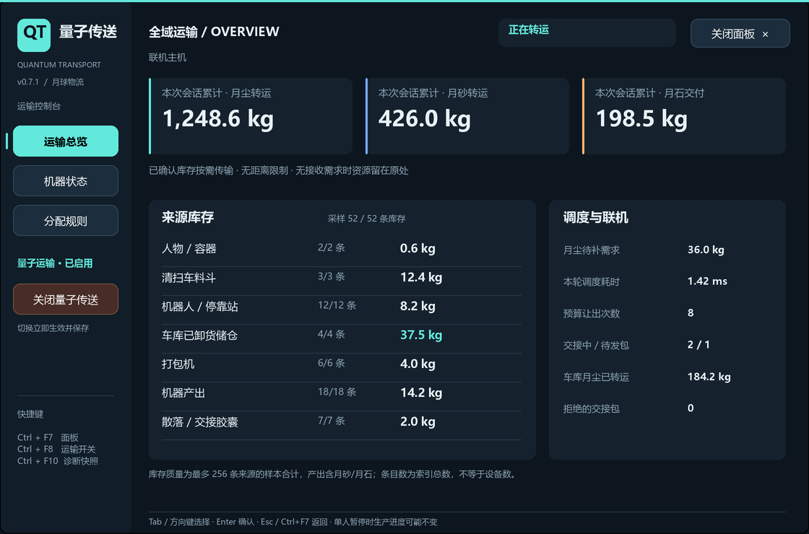
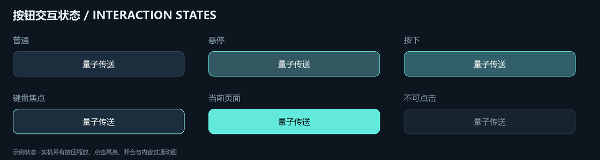

# 量子传送 / Quantum Transport

为 **Moon Sweepers** 提供全图、按需、保留资源归属的量子物流，以及游戏内运输控制台。

当前版本：**0.7.0**。资源调度沿用0.6.1的规则，本版重点改进按钮视觉状态、交互动画、切页和操作体验，并补齐项目文档。

**下载安装包：** [完整一键安装包（包含加载器和运行时）](https://github.com/dfggsfs/MoonSweepers-QuantumTransport/releases/download/v0.7.0/QuantumTransport-0.7.0-OneClick.zip) · [仅插件包](https://github.com/dfggsfs/MoonSweepers-QuantumTransport/releases/download/v0.7.0/QuantumTransport-0.7.0.zip) · [发布说明与 SHA-256 校验文件](https://github.com/dfggsfs/MoonSweepers-QuantumTransport/releases/tag/v0.7.0)。普通玩家优先下载完整一键包；GitHub 的 `Code → Download ZIP` 和 Release 中的 `Source code` 为源码压缩包，不能直接安装。

> 本项目是玩家 Mod，与游戏开发商没有从属关系。实现和离线检查已完成的部分、玩家已验证的部分，以及尚待实机验证的部分，在本文中分别说明。

## 1. 能做什么

- 玩家扫帚采集、已存放容器、清扫车料斗、近处及远处机器人、机器人停靠站、打包机库存、**已经卸进车库储仓的月尘**，可直接供给兼容加工机。
- 加压舱产出的月砂直接供应压石机；压石机成品月石自动交付原版收集站。
- 不要求来源和目标相邻，不要求连接传送带；无需求时资源留在来源。
- 处理多机器分配、配方需求、容量、贡献归属及扣账失败回滚。
- 支持主机统一调度和客户端资源交接。完整个人自动采集功能需要双方安装兼容版本。
- 游戏内三页面板展示运输总览、库存样本、机器状态、分配规则和联机信息，并提供运输启用/关闭按钮。

**月石入站不等于立即出售。** Mod调用原版交付流程保留站点容量、贡献和加工品溢价记录；仍由原版发射和结算获得收益，不直接修改余额，不自动发射。原版配方、加工时间、供电与采集奖励仍由游戏处理。



上图以及随包的 `preview/` 图片使用与游戏面板相同的布局描述和示例数据离线绘制，**不是实机截图**，也不是玩家实际库存。



## 2. 支持环境

| 项目 | 当前固定适配 |
| --- | --- |
| 操作系统 | Windows x64 |
| 游戏 | Moon Sweepers 1.0.4，Steam Build 26203101 |
| Unity | 6000.6.0f1，IL2CPP，metadata v108 |
| 加载器 | Lustral 0.1.0，Windows x64 / IL2CPP |
| 完整包运行时 | 上游加载器自带的 .NET 运行时，无需玩家另装 SDK |
| 开发编译 | .NET 10 SDK；当前工程脚本使用 `tools/dotnet/dotnet.exe` |

安装器和运行时均检查游戏核心文件指纹。游戏更新后即使版本显示相近，指纹不匹配也会停止，不能承诺跨构建兼容。

```text
GameAssembly.dll
82b2e7f2a049c332e836fd9b492ce2fa16c1600de1d276b4b79742daf15adea0

MoonSweepers_Data/il2cpp_data/Metadata/global-metadata.dat
f5ac72f32a8d9f5992ec793265b6dec0092a7358c342194fd0afb4e193119c1b
```

## 3. 安装、升级与停用

### 完整一键包：推荐给玩家

1. 在游戏内保存并正常关闭游戏。
2. 解压 `QuantumTransport-0.7.0-OneClick.zip`。
3. 将整个 `QuantumTransport-0.7.0-OneClick` 文件夹放到游戏目录，与 `MoonSweepers.exe` 并列。
4. 双击文件夹内的 `一键安装.cmd`，需要写入管理员目录时按Windows提示授权。
5. 等待“安装成功”，再从Steam正常启动。

```text
Moon Sweepers/
├─ MoonSweepers.exe
├─ GameAssembly.dll
├─ MoonSweepers_Data/
└─ QuantumTransport-0.7.0-OneClick/
   ├─ 一键安装.cmd
   ├─ 安装前检查.cmd
   ├─ README.md
   ├─ scripts/
   └─ payload/
```

不要直接在ZIP里运行、只复制脚本、放进Mods目录，或多套一层文件夹。**完整安装器按自身文件夹的父目录识别游戏**，支持其他盘符，不限定默认Steam路径。

完整包包含加载器、运行时和Mod；不包含游戏DLL、个人存档、玩家配置或开发者生成的游戏专用接口。首次按本机游戏文件生成接口，可能需要联网访问GitHub下载Unity补全库；已有完整且匹配的接口缓存会复用。

`安装前检查.cmd`只检查包、游戏版本和加载器冲突，不生成接口、不安装、不启动游戏。安装前至少预留2GB空间，较大的存档与旧安装需更多空间。

### 升级与备份

- 关闭游戏，按上述步骤运行新版完整安装包即可。旧包的日志和备份可以移到别处保留。
- 原配置保留；加载器下次启动补齐缺失的新配置项。原来关闭运输，升级后仍保持关闭。
- 仅替换本Mod和声明的加载器文件；其他Mod、加载器数据和玩家存档不覆盖。
- 检测到未知的 `winhttp.dll`、其他加载器或不兼容Lustral时停止，不自动混装。
- 原加载器、插件、配置和当前用户存档备份到游戏目录 `QuantumTransportBackups/<时间编号>/`。备份在替换安装文件前完成并核验。
- 存档复制和SHA256校验使用长路径接口，保留0.5.0安装器修订2的修复，无需修改注册表或系统长路径设置。
- 可捕获的失败会按安装日志恢复本次已替换文件；断电、强制结束或磁盘损坏可能中断恢复。保留 `install-journal.json`，不要把旧存档备份直接回写成当前存档。
- 提升权限时携带原玩家的存档位置与SID；仅为该玩家准备加载器配置、日志和运行数据的必要写入权限。

### 已有加载器的插件包

`QuantumTransport-0.7.0.zip`仅含插件、配置模板、安装脚本和说明，需要先有匹配的Lustral及游戏接口。普通玩家优先使用完整一键包。

### 停用与回退

- 面板的“关闭量子传送”或Ctrl+F8停止新增量子转运，并保存 `enabled = false`，不撤回已进入机器的资源。
- 原版物流继续处理它原本拥有的资源。已交接的真实胶囊仍是世界物品，不因关闭运输自动退款或复制一份。
- 临时关闭UI可在退出游戏后设置 `enable_dashboard = false`，物流功能仍可单独使用。
- 如需移除插件，先保存退出，移走 `Mods/local.quantumtransport` 并保留备份。不要删除其他Mod使用的加载器。
- 如需回退代码，使用备份中的插件及相应配置，先核对版本；安装器不会自动把旧存档覆盖回当前存档。

## 4. 游戏内面板与操作

| 操作 | 功能 |
| --- | --- |
| Ctrl+F7 | 打开/关闭面板 |
| Esc、右上角“关闭面板” | 关闭面板，返回原界面 |
| 左侧“启用/关闭量子传送”、Ctrl+F8 | 共用运输总开关，立即影响后续调度并保存配置 |
| Tab、方向键、Enter | 原生UGUI按钮导航和确认 |
| PgUp / PgDn | 在机器页翻页 |
| Ctrl+F9 | Info / Debug日志级别切换并保存 |
| Ctrl+F10 | 写出诊断状态快照 |

### 三页内容

1. **运输总览**：本次会话月尘/月砂转运与月石交付累计；各类来源的库存样本；调度耗时、需求及联机积压。
2. **机器状态**：每页7台加压舱/压石机的输入库存、容量、周期进度、完成次数。第一页和最后一页的越界按钮禁用。
3. **分配规则**：当前月尘模式、两类机器的优先级、压石机预备量、打包机保留量和各来源开关。此页显示规则，当前只提供运输总开关，不在UI里编辑配方参数。

### 0.7.0交互改进

- 按钮采用独立圆角UGUI面板与统一色板，不再叠加原版玻璃按钮材质和自动ColorTint。
- 区分普通、悬停、按下、键盘焦点、当前页面与禁用状态；文字按背景选择高对比颜色。
- 提供轻微按压缩放、点击高亮、选中指示条移动、开合淡入淡出及内容切换过渡。
- 切页只对内容区做动画，侧栏、关闭按钮与运输开关保持可用；快速操作保留最近请求，过渡中的旧内容不能被重复点击。
- 底部显示当前按钮的操作提示；切换运输后显示“配置已保存”的短反馈，面板保持打开。
- 动画使用单调时钟，不依赖游戏 `timeScale`；可设置 `reduce_dashboard_motion = true` 跳过动态效果，保留静态状态反馈。
- 窗口、分页数据和按钮状态分开更新。动画本身只更新控件，不执行库存事务；库存读数常态约每秒刷新一次，切页或切换开关时额外刷新。

### 数据范围与菜单行为

来源库存质量最多读取256条，按类别交错采样，显示每类“已采样数/索引总数”。**样本质量不是任意规模下的全图总质量**；同一设备按贡献者分成多条记录，条目数不等于机器数。机器产出样本可能包含月砂/月石。

累计量从本次进程会话开始统计，重启清零，不能当作存档历史总产量。运输关闭时来源索引可能是缓存，面板会注明。客户端显示本机采集来源；工厂和全局累计由主机管理，不把未知全局值显示成真实0库存。

面板借用本地玩家的原版暂停菜单与自有模态层来管理鼠标和操作屏蔽。单人暂停时，原版生产进度可能不变。已有保存/显示确认弹窗时不覆盖。关闭只释放本面板取得的资源：自己打开的菜单用 `Resume` 返回；原本已打开的暂停菜单继续保留。退出、场景切换和异常清理使用幂等释放。

**历史教训**：0.6.0曾把原版 `CloseWindow` 误作菜单关闭，实际触发保存退出；0.6.1已修复。本版继续检查编译后的Mod IL，禁止调用原版退出/离开世界接口及 `Application.Quit`。自有模态层的原版确认/取消回调被清空，避免底层对话框再次处理面板按键。

## 5. 资源来源与归属

| 来源 | 读取位置/策略 | 归属与去重 |
| --- | --- | --- |
| 人物当前采集库存 | 原版已入账的 `inventoryMass` | 按玩家记录；不提前计算尚未完成的清扫 |
| 人物存放容器 | `toolMass` 中非当前装载容器 | 当前容器已由人物库存表示，排除重复 |
| 清扫车/车辆料斗 | 明确登记的 `vehicleStorage` | 购买车辆沿用登记所有者；起始/驾驶原型通过真实组件补充身份；联机按控制权读取 |
| 近处机器人/停靠站 | `RobotStorageId`、`DockStorageId` 对应库存 | 用实际停靠站归属映射，不将同一字典条目注册两次 |
| 远处机器人 | `farRobots.kilograms` 及原版停靠站记录 | 只读取已完成、已入账载荷，不读取工作进度；存在近处视图时排除远处替代表现 |
| 打包机 | `PackagerStoragePrefix(id) + owner` | 按后缀归属；保留量按每台机器跨归属合计 |
| 车库已卸货储仓 | `GarageSiloPrefix(garage) + player` | 保留原版卸货记录的玩家归属，不改成车库建筑所有者；和车辆料斗是不同库存 |
| 机器产出 | 加压舱月砂/压石机月石产出槽 | 按产出槽原贡献者读取 |
| 散落/联机交接胶囊 | 真实 `canisters` | 只读取未手持、未飞行、未在传送带上的对象；用原版编号和回执防重复 |

所有来源均检查身份和有效库存。无法明确确认归属、快照ID不一致或未识别的特殊工具不猜测、不强制清空，留在原处并计入诊断。多个来源没有“机器人优先于人物”的固定业务优先级，也没有固定供料比例；调度器轮询来源，合并本轮可用供应量后统一规划。

车库接入不再次执行采集奖励、卸货或打包流程，只在已经真实存在的储仓余额和目标输入之间转移，因此不会再次领取采集收益。未接通传送带也可从储仓供料；原版传送带仍可处理剩余库存。

## 6. 当前分配规则

### 月砂与月尘

- 加压舱只接收它兼容的月尘输入；月砂供应兼容的压石机输入口。
- 每轮先规划月砂，再规划月尘。月砂转入压石机后更新其月尘需求。
- 加压舱月尘需求为实际输入空余容量。
- 默认 `RecipeBalanced` 下，压石机月尘目标为：

```text
目标月尘 = min(月尘输入容量, 未加工的输入月砂 + 预备月尘)
本次可接收 = max(0, 目标月尘 - 已存月尘)
默认预备月尘 = 1 kg
```

当前支持的原版压石配方消耗等质量月尘和月砂。已经进入加工批次的月砂不再算作待配对输入。没有月砂的压石机只预存1kg月尘；现有库存超过目标时只停止新转入，不回收、不丢弃原库存。

`CapacityFair` 则按压石机全部月尘输入空余容量接收，不使用上述配方限额。

### 优先级与公平分配

`chamber_dust_priority` 和 `press_dust_priority` 默认都为0。数值越大越先满足该类机器；高优先级仍受容量和配方限额约束，持续高优先级需求可能使低优先级等待。

同级使用等份供应、达到需求上限后重分剩余量的方式，而非按机器容量比例或按距离分配。例如：

| 本轮可用月尘 | 加压舱需求 | 压石机需求 | 分配结果 |
| --- | --- | --- | --- |
| 6kg | 20kg | 12kg | 各3kg |
| 10kg | 20kg | 1kg | 加压舱9kg，压石机1kg |
| 12kg | 2kg | 3kg | 各满足需求，剩余7kg留在来源 |

这是平均分配**本轮新增供应量**，不会把现有库存拉到同一水平；也不是依据电力、生产速度或机器距离决定份额。接收口资格以兼容输入及需求为准，当前没有单独的“暂停/断电机器不供料”过滤器。

### 保留量与预算

`packager_dust_reserve_kilograms` 默认0。每台打包机跨贡献者合计只转出超过保留量的部分，原版传送带不受该量子保留规则约束。人物、车辆、机器人和车库没有额外的最低保留量。

公平规划面向本轮被扫描到的来源和需求缓存；时间/事务预算不足时只提交计划的前一部分，并轮转来源、采样口和目标续传。规模很大时不保证同一帧全部机器收到等额资源，也不承诺固定完成时延。没有接收空间或兼容机器时不扣来源。

## 7. 联机权限与交接

| 位置 | 可直接处理 |
| --- | --- |
| 单人 | 本世界已识别来源、机器分配和交付 |
| 主机 | 共享工厂、机器人、车库储仓、主机人物库存、无人驾驶或主机控制的车辆 |
| 客户端 | 自己的人物/存放容器和自己当前控制的车辆；通过交接送给主机 |

完整功能建议所有参与自动采集的玩家安装同版，主机与客户端均开启 `enabled`、`enable_coop` 及相应来源开关，主机还需开启 `collect_loose_capsules`。

交接流程：

1. 主机通过大厅能力公告发布会话、来源许可和月尘需求；客户端校验主机身份和公告时效。
2. 客户端仅从有权限的来源取已入账月尘，用原版打包创建有真实唯一编号的胶囊，保留贡献归属。
3. 自定义 `QTH5` 包传递胶囊和必要来源快照。包上限60KiB，限制深度、字符串、质量、容量和姿态数据。
4. 主机核对成员身份、会话、分配的编号区间、车辆控制权及原生编号冲突，接收一次并返回ACK。
5. 首次发送未成功排队时撤销本次临时交接；已经排队后按同一个编号重试，不反复扣原来源，不因超时自动退款。
6. 主机将真实胶囊作为来源按需供料；已接收和已消耗编号分别用压缩区间回执记录，读档后继续去重和避让编号。

默认每客户端最多8个未消耗交接对象，每轮新建最多1个；无需求、未就绪或积压时停止新增交接。回执在原版快照的 `qt.receipt.v1:`、`qt.handoff.v1:` 零资源记录中保存，不增加可用资源，不应手工删除。

只装主机时，共享工厂、主机来源和机器人/车库可处理，但不会擅自扣减未装Mod客户端的手持库存和正在驾驶的料斗。未装客户端原版打包放下的胶囊可作为来源。只装客户端而主机没有可用能力公告时，客户端等待，不独自结算工厂。

主机迁移、异版本组合、任意强制退出后的绝对恢复和真实网络断线表现没有完整实机保证。算法重试模型通过不等于Steam联机验收；数量核对需包含胶囊、机器输入、加工中材料、成品、站点及已发射货物。

主机转运后通过 `nextMachineStorage`、`nextProduction` 和 `walletDirty` 提醒原版发送/去重必要快照；这里的 `walletDirty` 是同步标记，不是直接增加钱包余额。

## 8. 实现架构与关键取舍

```text
Lustral 生命周期 / 原版游戏 Update
              │
              ├─ Update：快捷键、UI视觉反馈、低频汇总
              └─ LateUpdate：发现真实 MoonWorld → 权限 / 保存状态检查
                                             │
                客户端：本地来源 → 原生胶囊交接 ┤
                单人/主机：来源索引 → 按需规划 → 库存事务 → 原版交付
                                             │
                                      诊断 / 原版保存与同步
```

### 代码职责

| 模块 | 文件/位置 | 作用 |
| --- | --- | --- |
| 入口与设置 | `src/QuantumTransport.Mod/QuantumMod.cs` | 生命周期、快捷键、配置、世界发现、异常停用 |
| 调度 | `TransportManager.cs` | 来源/需求缓存、预算、轮询、批量计划和实际提交 |
| 采集与车库 | `CollectionSources.cs` | 真实来源身份、贡献者映射、客户端权限和近远机器人去重 |
| 胶囊与回执 | `CapsuleSources.cs` | 实体状态过滤、读取、消耗回执和原版通知 |
| 联机 | `CoopCoordinator.cs`、`NetworkPatch.cs`、`NativeHandoff.cs`、`NativeWire.cs` | 主机公告、权限、原生交接、消息与重试 |
| 月石交付 | `StoneDelivery.cs` | 调用原版 `CrewCargoDeposit` 并核对站点/贡献余额 |
| 游戏面板 | `Dashboard.cs` | UGUI创建复用、鼠标命中、原版菜单租约、交互与动画呈现 |
| 无游戏依赖的核心 | `src/QuantumTransport.Core/` | 分配、配方、事务、编号区间、来源身份、UI布局/主题/动画状态 |
| 诊断 | `Diagnostics.cs`、`ProductionAudit.cs` | 限流轮转日志、快照、只读生产审计 |
| 安装 | `scripts/complete/` | 校验、权限、完整加载器、备份、接口生成和回滚 |
| 检查/打包 | `tests/`、`tools-src/AssemblyInspector/`、`scripts/` | 算法/配置/接口/安装回归，显式清单打包与发布校验 |

### 库存事务

每次提交前重新检查来源存在、当前余额和目标有效空间，不只相信缓存。`TransferCommit` 在主线程为目标按原贡献者加量、扣减来源、读回核对质量守恒；任一步骤失败尝试恢复双方余额。回滚不完整则记录全部异常并停用本次会话物流，不继续放大错误。

站点交付用 `DeliveryCommit` 单独核对原版实际接收量与站点增量；满站不扣来源，部分接收只扣实际接收量。失败恢复对应的贡献、溢价、入站总量和脏标记。这里不调用直接加钱接口。

### 调度、缓存与性能

- 默认100ms调度一次，来源索引默认1000ms低频兜底刷新；结构签名和相关集合数量变化会提前刷新。
- 单人/主机的普通调度在原版保存尚未完成时等待，保存任务失败时报告并暂停该调度；有成功转运时至多约每5秒请求一次原版保存，不直接重写存档格式。
- 机器、胶囊和采集来源分开缓存；新交接胶囊不要求重新扫描整座工厂。
- 来源前缀使用索引匹配，批量规划先合并同资源供应，避免每个来源重复对全部机器求解。
- 默认每轮最多检查128来源、刷新128接收口、完成128库存事务，使用轮询游标防止尾部长期跳过。
- 4ms是热调度**软预算**。索引重建、分配计划、单次原生调用、日志和保存不能任意中断；UI探测、客户端快照序列化等不属于完整帧时间承诺。
- 面板动画只处理已创建的少量控件，不调用库存事务；UI每次库存探测最多256条，常态约每秒一次，切页/开关会额外刷新；机器页只读当前7台。

### 原版流程与ABI

当前只有一个既有Harmony网络钩子：`MoonCrewSession.HandleWorld(UInt64, byte[])`。自定义帧之外的消息交给原版处理。

**不拦截、不整体禁用 `StepConveyors(float)`。** 原版函数还推进打包、捕捉、车库和生产；整体跳过会破坏加工。当前Il2CppInterop V2对Single包装的本机detour ABI也曾导致浮点参数寄存器不匹配。本项目改在Lustral帧末事件处理库存，保留原版生产调用。正常调用已生成接口与错误地钩住浮点函数不是同一种操作。

### UI与菜单安全

原版 `MoonMenuKit` 继续提供字体、标签和圆角面板；按钮使用普通 `UnityEngine.UI.Button`、普通Graphic和显式 `Transition.None`，交互色由 `DashboardTheme` 控制，避免玻璃材质与Selectable自动染色相乘。布局描述由Unity渲染器和离线预览共享。

`DashboardMotion` 只管理透明度、微小位移和切换阶段；中断开合、减少动态效果、快速切页不应改变世界数据。`DashboardMenuLease` 在执行清理回调前先清空归属，保证重复关闭和重入只释放一次。UI异常独立记录，不直接作为运输提交失败处理；游戏退出接口保持禁止调用检查。

## 9. 配置

文件位置：`<游戏目录>/Lustral/config/local.quantumtransport.toml`。退出游戏后修改，下次启动生效；面板总开关和日志快捷键会即时保存相应值。完整模板见 `distribution/default-config.toml`。

| 配置项 | 默认值 | 作用/边界 |
| --- | --- | --- |
| `enabled` | `true` | 量子运输总开关 |
| `dust_distribution` | `RecipeBalanced` | 配方限额；也支持 `CapacityFair` |
| `chamber_dust_priority` / `press_dust_priority` | `0` / `0` | -100～100，越大越先供料 |
| `press_dust_buffer_kilograms` | `1.0` | 压石机额外预备月尘，0～12kg |
| `packager_dust_reserve_kilograms` | `0.0` | 每台打包机合计保留量，0～1000000kg |
| `collect_player_dust` | `true` | 人物及存放容器 |
| `collect_vehicle_dust` | `true` | 车辆料斗 |
| `collect_robot_dust` | `true` | 机器人和停靠站 |
| `collect_garage_dust` | `true` | 已卸货车库储仓，独立于车辆料斗开关 |
| `collect_loose_capsules` | `true` | 可读取的散落胶囊及主机交接来源 |
| `deliver_stone` | `true` | 月石交付原版站点 |
| `enable_coop` | `true` | 联机运输 |
| `poll_interval_milliseconds` | `100` | 调度间隔，16～1000ms |
| `max_sources_per_tick` | `128` | 每轮来源检查上限，16～4096 |
| `max_receiver_samples_per_tick` | `128` | 每轮接收口刷新上限，16～4096 |
| `max_transfers_per_tick` | `128` | 每轮库存事务上限，16～4096 |
| `tick_budget_milliseconds` | `4.0` | 1～20ms，软预算 |
| `catalog_refresh_milliseconds` | `1000` | 索引兜底刷新，250～10000ms |
| `network_sync_milliseconds` | `250` | 主机同步提醒最短间隔，100～2000ms；发送仍沿用原版节流 |
| `max_client_capsules_in_flight` | `8` | 每客户端未消耗对象上限，1～32 |
| `client_capsules_per_tick` | `1` | 每轮新交接对象上限，1～4 |
| `enable_dashboard` | `true` | 游戏内面板 |
| `reduce_dashboard_motion` | `false` | 跳过动态过渡和缩放，保留状态颜色 |
| `log_level` | `Info` | Off / Error / Warn / Info / Debug |
| `summary_interval_seconds` | `15` | 汇总间隔，2～300秒 |
| `run_native_checks` | `false` | 手动原生接口诊断；默认不自动执行 |

数值会在加载时校正为支持范围，NaN/无穷值回退安全默认值。已有配置迁移使用实际加载器绑定逻辑，保留旧值并补齐新字段。

## 10. 日志与排查

Mod诊断目录：`<游戏目录>/Lustral/data/local.quantumtransport/diagnostics/`。

| 文件/字段 | 含义 |
| --- | --- |
| `status.json` | 最近状态、版本、配置摘要、来源/调度/联机/生产及面板错误 |
| `quantum.jsonl` | 结构化事件；约2MiB轮转，保留两份旧日志 |
| `network` | 角色、交接中对象、待ACK包、暂缓/拒绝原因和发送失败 |
| `scheduler` | 本轮扫描、采样、事务、耗时、峰值和预算让出；不是完整游戏帧时间 |
| `stats` | 转运及来源计数；`NonemptySources`保留历史名字，实际是本轮来源窗口大小，`AvailableKilograms`也只是本轮扫描量 |
| `production` | 最多32台机器的只读审计及站点库存，不等于UI分页范围 |
| `dashboard` | 面板启用状态、可见状态及最近UI错误 |

Debug转运明细最多20条/秒，抑制量单独计数；大量机器长时间运行建议保留Info。Ctrl+F10可手动留快照。

加载器日志位于 `Lustral/Logs/`；Unity日志通常位于用户 `AppData/LocalLow/DragDropGames/MoonSweepers/Player.log`。完整安装器日志在安装包 `logs/<时间>/`，备份与安装journal在游戏目录 `QuantumTransportBackups/`。插件包的 `收集日志.cmd` 仅复制诊断、限量日志、配置和文件哈希，不含存档、不上传；联机问题需双方日志。

| 现象 | 优先检查 |
| --- | --- |
| 无转运 | enabled、角色、来源开关、真实入账库存、兼容机器、需求和保存状态 |
| 压石机不继续收月尘 | 先检查输入月砂和1kg预备限额，不只看空余物理容量 |
| 机器有料但不加工 | 原版供电、配方、输出空间、暂停与生产进度 |
| 车库不出料 | 是否真正卸进储仓、collect_garage_dust、主机权限、已识别ID；不要把料斗当储仓 |
| 客户端等待 | 主机能力公告、双方开关、Joining、需求、积压和网络暂缓原因 |
| 交付后钱包没变 | 先看原版站点库存，仍需发射结算 |
| UI无动画 | reduce_dashboard_motion配置；原版暂停不应停止UI动画时钟 |
| UI打不开 | 是否进入真实世界、enable_dashboard、已有确认弹窗、dashboard.error |
| Steam进程在但无窗口 | 先分清Steam预启动同步卡住与游戏进程已创建，检查新日志时间，不能仅凭现象归因Mod |
| 安装备份失败 | 确认使用当前完整包、保留日志；长路径修复已包含，不需要删除存档 |

## 11. 开发、构建与验证

源码目录概览：

```text
src/QuantumTransport.Core/       无Unity依赖的核心算法与UI状态
src/QuantumTransport.Mod/        IL2CPP适配、调度、联机、UI
tests/QuantumTransport.Checks/   控制台离线回归与算法基准
tests/Test-*.ps1                 隔离目录内的安装器/权限/长路径/启动脚本检查
tools-src/AssemblyInspector/     接口、配置迁移与编译IL检查
scripts/                        构建、预览、打包、安装与发布校验
distribution/                   玩家说明和默认配置
analysis/                       只读原版接口/本机代码分析资料
artifacts/                      本机生成的检查证据及示例预览
dist/                           声明清单生成的发布包
```

工程需要本机匹配的游戏与已生成interop、加载器核心DLL，以及对应SDK/开发工具。游戏和生成的接口不能从普通源码文本中重建，也未作为玩家包直接分发。

默认工程引用和AssemblyInspector使用默认Steam安装路径。`QuantumTransport.Mod.csproj`支持 `GameDir` 属性覆盖编译引用；完整检查工具中的游戏路径仍需同步调整。此开发路径限制与完整版安装器从父目录识别任意盘符是两回事。

在项目根目录运行：

```powershell
# 编译（警告视为错误）、核心/联机/车库/UI离线回归、算法基准、接口及配置检查
powershell -NoProfile -ExecutionPolicy Bypass -File scripts/Build.ps1

# 用现成SDK单独编译到其他游戏目录引用（不替代完整检查）
tools/dotnet/dotnet.exe build src/QuantumTransport.Mod/QuantumTransport.Mod.csproj -c Release -p:GameDir="D:/SteamLibrary/steamapps/common/Moon Sweepers"

# Python与Pillow准备好后，从共享布局生成示例预览
python scripts/render_dashboard.py

# 打包插件包，再组合官方加载器为完整包
python scripts/package_release.py
python scripts/package_complete.py

# 完整包就绪后，隔离安装器测试；复用此前单独验证的完整本机接口
powershell -NoProfile -ExecutionPolicy Bypass -File tests/Test-CompleteInstaller.ps1 -ReuseVerifiedInterop
powershell -NoProfile -ExecutionPolicy Bypass -File tests/Test-CompleteLauncher.ps1
powershell -NoProfile -ExecutionPolicy Bypass -File tests/Test-InstallerPermissions.ps1
powershell -NoProfile -ExecutionPolicy Bypass -File tests/Test-InstallerLongPaths.ps1
```

打包要求对应版本审计说明、预览、已通过的检查证据和固定的官方加载器归档先准备好，不自动下载开发SDK。默认拒绝覆盖已有版本目录；`--refresh`只允许刷新严格符合旧清单、没有额外日志/备份/用户文件的生成目录。更新检查证据后需刷新完整包，随后核对ZIP与清单。

`python scripts/verify_release.py`核验两个ZIP、清单、编译产物、安装器证据和**本机已安装**插件是否一致；因此需先安装本次版本，不是面向任意未安装机器的独立检查。所有这些步骤均不自动启动游戏。

### 覆盖范围

- 核心回归：容量、公平分配、配方/保留量、质量守恒、故障回滚、站点贡献、来源身份、轮询、联机权限、交接/重试/编号区间。
- UI回归：菜单重复释放/重入、禁用分页、所有按钮提示、主题对比度、颜色插值、不同帧步长、切页阶段、减少动态效果和开合中断。
- 接口检查：实际生成程序集中的契约、实际加载器配置迁移/保存、只保留既有网络钩子、编译IL禁止退出调用、按钮不再使用玻璃控件。
- 安装回归：复制的游戏文件、私有测试用户目录、长路径模拟存档、重复安装、损坏缓存、权限恢复和故障回滚。未模拟真实UAC操作，也不把缓存生成验证当成新的联网下载验证。
- 算法基准只测托管批量规划器，排除Unity/原生库存、Steam、日志、保存和索引成本，**不是FPS或完整调度耗时**。

### 实机验证边界

玩家此前明确验证过打包机→加压舱→压石机、多机分配与拆除，随后反馈0.6.1的面板修复完成度较高。不能据此宣称所有采集工具、车库、双人联机和异常恢复情形都已完成逐项验收。**0.7.0新增颜色、动画和输入体验需玩家实测**，离线预览和通过的断言不是实际游戏操作录像。

建议复测：连续切三页、快速翻页、首尾禁用、鼠标与键盘切换、点击总开关、开合中按Esc、原本已开暂停菜单时打开、保存/场景切换、不同分辨率、减少动态效果，以及原有采集加工链。关闭面板后应恢复原界面，关闭运输后应保留现有资源。

## 12. 已知边界与后续方向

- 固定游戏构建，更新游戏后需重新核对接口和本机行为。
- 自动供料不根据电力或生产速度预测最优配比，也不从机器撤回旧库存。
- 高优先级持续需求可延迟低优先级；预算和索引刷新使大规模供料存在多轮延迟。
- UI质量是采样，当前面板不是全图实时库存数据库；客户端不能查看并伪造主机全局数据。
- 特殊未登记工具、主机迁移、异版本联机和任意崩溃恢复仍需进一步支持与实机证据。
- 下一步若扩展编辑规则、按单机优先级、来源保留量或全球物料统计，应继续保持归属、容量与事务边界，并单独验证性能。

## 13. 版本记录

| 版本 | 主要变化 |
| --- | --- |
| 0.7.0 | 统一按钮与视觉状态、开合/切页/按压反馈、分页禁用、操作提示、减少动态效果、完整README |
| 0.6.1 | 修复面板错误调用保存退出；加入运输启用/关闭按钮与回归防护 |
| 0.6.0 | 车库储仓接入、三页面板；该版本存在面板退出问题，应升级 |
| 0.5.0 | 主机权威联机交接、ACK/重试、回执区间、规模调度；随后完整安装器修订2修复长路径备份 |
| 0.4.0 | 采集来源与月石原版交付 |
| 0.3.x | 配方感知月尘、优先级与打包机保留量 |
| 0.2.1 | 修复输入后不生产的浮点钩子问题；玩家验证基础加工链 |

## 14. 第三方组件与发布内容

完整包组合未经修改的Lustral 0.1.0官方归档及其依赖，固定SHA256为：

```text
9dda93f4e2a10830fab8fd6b196562398d89e4760f492e3f7b1e9ade6d9e917b
```

加载器与Il2CppInterop的许可文本、依赖说明和对应源码归档随完整包的 `licenses/` 提供；上游源码位置也在该目录说明中列出。Unity补全库在需要时由上游生成器从指定源下载并核验，未在本项目中打包个人游戏接口。游戏内中文字体和素材来自运行中的原版游戏，不作为字体文件重新分发。

本项目自身的独立发布许可尚未指定；第三方组件的出处和许可与Mod源代码的许可应分别处理。
